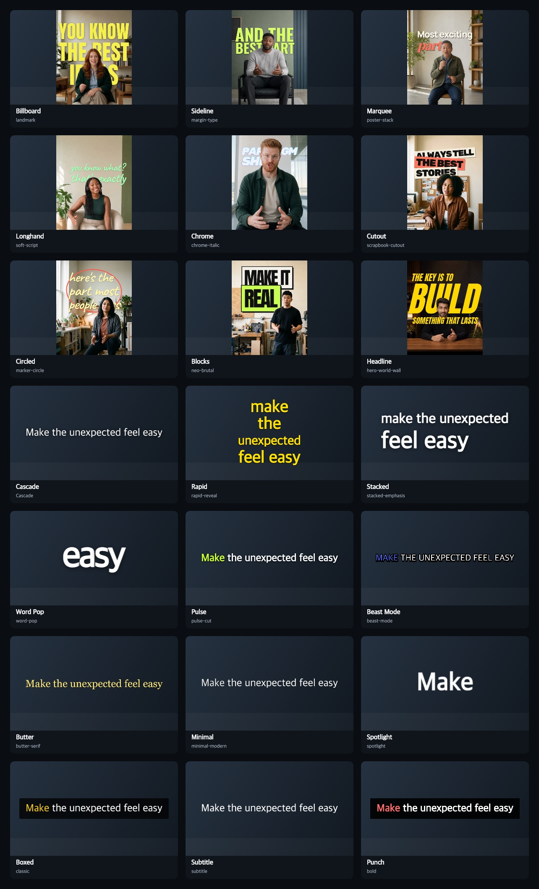

# Add synced captions

Use Cardboard's transcript timings so captions follow the edited clips and their source trims. `cb audio captions`
transcribes audible clips that do not have a cached transcript yet, then builds caption items with word timings.

Inspect the gallery and choose a style visually. Each card shows the preset ID to pass to `--preset`; the Behind Subject
cards use footage samples, and the other cards show the rendered caption style on a neutral background. The gallery
shows a still frame, so use the editor to judge motion.



```sh
cb audio captions <project> --apply
```

Use `--words <n>` to change the number of words in each caption, `--preset <id>` to apply the ID chosen from the
gallery, and `--language <code>` when the speech language should be specified. Transcription uses credits when no cached
transcript exists; read `cb docs audio` for details.

After applying the track, run `cb verify <project>` and inspect representative frames with
`cb look <project> --at <times>`. Review the transcript for names and homophones, and edit any wording or timing that
needs correction. The app can restyle or retime the generated captions because each item keeps its text and word
timings.
